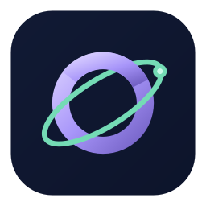

# Orbe

**Tempo e finanças em sintonia.** Agenda e calendário financeiro em C#/.NET MAUI para Windows/Android, com site e API ASP.NET Core/PostgreSQL na nuvem.

## Versão 2.0 — ambiente de testes

A versão 2 centraliza contas, agenda e financeiro na Discloud e funciona com o computador principal desligado. O aplicativo usa login; a demonstração foi removida. O Nexus permanece independente e o histórico antigo é importado uma única vez, com backup e conferência.

**Ambiente de testes:** cadastro de clientes e reservas estão liberados, por decisão do proprietário, sem confirmação de e-mail. O site identifica esse modo; recuperação por e-mail continua indisponível. A administração está disponível e a linha anterior 1.0.2 permanece preservada.

- [Site de testes](https://orbe-willianbn.discloud.dev) · [Administração](https://orbe-willianbn.discloud.dev/equipe)
- [Versões e downloads](https://github.com/WillianBN-Dis/Orbe/releases)
- Downloads atuais 2.0.0: [Windows](https://github.com/WillianBN-Dis/Orbe/releases/download/v2.0.0/Orbe-Setup.exe) · [Android](https://github.com/WillianBN-Dis/Orbe/releases/download/v2.0.0/Orbe-2.0.0.apk). Android atual: build 20002/ajuste 2, sem configurar servidor no login. A conexão fica somente em Conta para o administrador.
- [Primeiros passos](docs/PRIMEIROS-PASSOS.md) · [Operação e backups](deploy/discloud/README.md)
- Android: **Atualizar aplicativo** no login e em Conta, a partir do **2.0.0 ajuste 1**. A versão exibida continua 2.0.0. [Como atualizar e publicar ajustes](docs/ATUALIZACOES-ANDROID.md).

## Agenda, equipe e financeiro

WillianBN cria/desativa funcionários, cadastra serviços e define as habilitações. Cada profissional configura a própria jornada, com períodos separados por dia, exceções, folgas e compromissos parciais ou integrais. O proprietário consulta todos, inclusive o histórico dos profissionais desativados. A autorização é verificada no servidor.

No aplicativo: calendário mensal e agenda do dia, criar/editar/excluir eventos, cancelar atendimentos, conta pessoal e gráficos financeiros animados por dia/mês/ano. Funcionários veem apenas a própria agenda e financeiro; o proprietário tem visão geral.

**Agendar não gera receita.** Lucro é receita menos despesa registrada. Cancelar libera o horário e mantém histórico/financeiro. Excluir o evento também exclui seus lançamentos vinculados em uma transação; avulsos são mantidos. Confirmações repetidas usam IDs estáveis para evitar duplicar lançamentos.

O fluxo público preparado é serviço → profissional → dia → horário → confirmação automática. A duração inteira precisa caber no intervalo livre. O servidor impede reservas sobrepostas/duplicadas, oculta detalhes de bloqueios privados e valida o prazo de cancelamento/remarcação, por padrão 24 horas. Preço/duração ficam congelados na reserva. Defaults: intervalos de 15 min, antecedência de 2 h, horizonte de 60 dias, fuso America/Sao_Paulo.

## Importação e primeiro acesso

A ferramenta de migração aceita somente o banco dedicado do Orbe, cria snapshot SQLite consistente incluindo WAL e preserva IDs, datas, centavos e vínculos. Não importa credenciais nem cria contas a partir de nomes antigos. WillianBN atribui os registros aos profissionais antes de abrir reservas. Nenhum banco pessoal é importado automaticamente; registros sem atribuição ficam privados ao proprietário.

O usuário inicial é WillianBN. A senha aleatória está protegida no PC de configuração e pode ser consultada pelo assistente local `deploy/discloud/Show-OwnerAccess.ps1`. Não há senha padrão no código. Troque-a após entrar. O botão Entrar como cliente abre o site.

## Infraestrutura e proteção dos dados

Discloud: site ASP.NET Core 512 MB, PostgreSQL 17 gerenciado 512 MB separado. Um launcher Node sem dependências inicia o servidor self-contained e os backups. HTTPS, senhas ASP.NET Identity, sessão opaca revogável, cookies HttpOnly/CSRF, tokens no SecureStorage e limites de requisições. Segredos ficam fora do Git e de wwwroot.

Backups diários cifrados no servidor, retenção de 7 dias e restauração comprovada em banco isolado; uma cópia privada também foi guardada no PC. Consulte o manual operacional para preservar o certificado, obter cópias externas e restaurar com segurança. A conta Discloud e o certificado de recuperação não devem ser tratados como substitutos dessas cópias.

## Compilar e verificar

Requer .NET 10, workload MAUI e os SDKs da plataforma. O projeto fixa MAUI 10.0.110, incluindo a correção do Voltar no Android 16. No Windows, `./release.ps1` gera instalador autocontido; `./release-android.ps1` gera APK assinado com assemblies embutidos. Chaves de assinatura ficam no perfil privado do desenvolvedor, fora do repositório. O instalador Windows não possui assinatura Authenticode.

As suítes e os testes de instalação estão em [tests/README.md](tests/README.md). O PostgreSQL de testes usa endereço/nome exclusivos e os dados são sintéticos. A implantação e as dependências nativas verificadas por SHA-256 estão documentadas em [deploy/discloud](deploy/discloud/README.md).

Decisões e checkpoints: [docs/PLANO-NUVEM.md](docs/PLANO-NUVEM.md), com cópia organizada no Obsidian do proprietário. As instruções de conexão direta ao Nexus pertencem à linha 1.x e podem ser consultadas no [histórico 1.0.2](https://github.com/WillianBN-Dis/Orbe/tree/v1.0.2).
